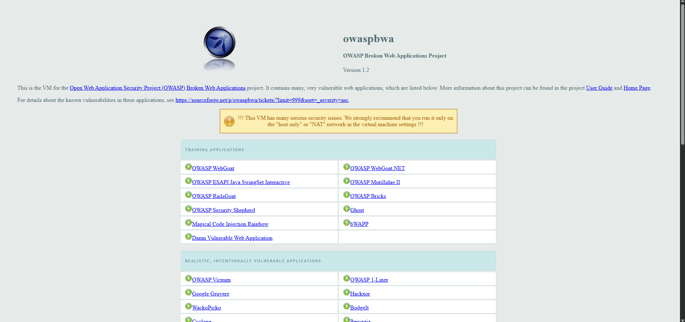

# OWASP Broken Web Applications on Proxmox VE



## Overview

This project documents the successful deployment of **OWASP Broken Web Applications (BWA) VM 1.2** on a Proxmox VE homelab server.

OWASP BWA is an intentionally vulnerable virtual machine designed for web application security training, penetration-testing practice, and security lab exercises.

The original virtual machine was distributed in VMware format. To run it on Proxmox VE, the virtual disk was converted from VMDK to QCOW2, and the virtual hardware configuration was adjusted to improve compatibility with the original VM.

## Environment

| Component | Configuration |
|---|---|
| Hypervisor | Proxmox VE 9.2 |
| Guest OS | Ubuntu 10.04 LTS |
| Application VM | OWASP BWA 1.2 |
| VM ID | 101 |
| VM Name | OWASP-BWA |
| CPU Cores | 1 |
| Memory | 1504 MB |
| Virtual Disk | 8 GiB |
| Disk Format | QCOW2 |
| Disk Controller | LSI Logic |
| Network Bridge | `vmbr0` |
| Guest IP | `192.168.10.5` |

## 1. Preparing the VMware Files

The original VMware archive contained the following files:

- `OWASP Broken Web Apps.vmx`
- `OWASP Broken Web Apps-cl1.vmdk`
- `OWASP Broken Web Apps-cl1-s001.vmdk`
- `OWASP Broken Web Apps-cl1-s002.vmdk`
- `OWASP Broken Web Apps-cl1-s003.vmdk`
- `OWASP Broken Web Apps-cl1-s004.vmdk`
- `OWASP Broken Web Apps-cl1-s005.vmdk`

The files were transferred to the Proxmox host:

```text
/var/lib/vz/dump/
```

The VMDK descriptor references the split disk extent files. All referenced files must be present during conversion.

## 2. Converting the Virtual Disk

The destination directory for the VM disk was created:

```bash
mkdir -p /var/lib/vz/images/101
```

The original disk descriptor was inspected:

```bash
qemu-img info -f vmdk \
"/var/lib/vz/dump/OWASP Broken Web Apps-cl1.vmdk"
```

The virtual disk was converted to QCOW2:

```bash
qemu-img convert -p -f vmdk -O qcow2 \
"/var/lib/vz/dump/OWASP Broken Web Apps-cl1.vmdk" \
"/var/lib/vz/images/101/vm-101-disk-0.qcow2"
```

The resulting disk was verified:

```bash
qemu-img info \
"/var/lib/vz/images/101/vm-101-disk-0.qcow2"
```

The conversion completed successfully. The resulting image had a virtual capacity of 8 GiB and occupied approximately 5.89 GiB on disk.

## 3. Creating and Configuring the VM

VM 101 was configured with the name `OWASP-BWA`. The converted disk was initially attached using IDE.

The initial boot reached GRUB but did not complete successfully.

To investigate the problem, the original VMware configuration was inspected:

```bash
grep -Ei \
'^(scsi|ide|sata|ethernet|firmware|memsize|numvcpus|guestOS|virtualHW.version)' \
"/var/lib/vz/dump/OWASP Broken Web Apps.vmx"
```

The original configuration contained:

```text
scsi0.present = "TRUE"
scsi0.virtualDev = "lsilogic"
scsi0:0.present = "TRUE"
scsi0:0.fileName = "OWASP Broken Web Apps-cl1.vmdk"
```

This indicated that the original VM used an LSI Logic SCSI controller.

## 4. Troubleshooting the Boot Process

The first boot attempt stopped before the guest operating system completed startup.

The disk controller configuration was identified as a potential compatibility issue because the original VMware VM used LSI Logic SCSI, while the Proxmox VM initially used IDE for the disk.

The VM was stopped and reconfigured:

```bash
qm stop 101
qm set 101 --delete ide0
qm set 101 --scsihw lsi
qm set 101 --scsi0 local:101/vm-101-disk-0.qcow2
qm set 101 --boot order=scsi0
```

The updated configuration was verified:

```bash
qm config 101
```

The relevant settings were:

```text
boot: order=scsi0
cores: 1
cpu: x86-64-v2-AES
memory: 1504
name: OWASP-BWA
net0: virtio=BC:24:11:54:F9:CB,bridge=vmbr0,firewall=1
ostype: l26
scsi0: local:101/vm-101-disk-0.qcow2,size=8G
scsihw: lsi
sockets: 1
```

After the controller change, the guest progressed through its boot process and reached the OWASP BWA welcome screen.

**Result:** Matching the original LSI Logic SCSI controller was followed by a successful boot.

## 5. Successful Boot

The guest displayed the following welcome message:

```text
Welcome to the OWASP Broken Web Apps VM

OWASP Broken Web Applications VM Version 1.2

You can access the web apps at:
http://192.168.10.5/
```

The console also provided administration information and the default credentials for this lab VM.

The successful boot confirmed that the converted virtual disk was usable and the guest operating system could start under Proxmox.


## 6. Accessing the Web Applications

The guest console reported the following addresses:

| Service | Address |
|---|---|
| OWASP BWA Web Applications | `http://192.168.10.5/` |
| phpMyAdmin | `http://192.168.10.5/phpmyadmin` |

Access from another device depends on the VM's network configuration and routing.

The VM's reported IP address should be verified against the actual lab network before troubleshooting connectivity.

## 7. Security Considerations

OWASP BWA intentionally contains vulnerable applications and outdated software.

For safe operation:

- Keep the VM on an isolated or restricted lab network.
- Do not expose the VM directly to the public internet.
- Avoid connecting it to networks containing sensitive systems.
- Only test systems that you own or are explicitly authorized to assess.
- Do not reuse the VM's default credentials on other systems.

The original guest specifically warns users to run the VM only on a host-only or NAT network. Verify the actual Proxmox network isolation before using the applications.

## 8. Skills Demonstrated

- Proxmox VE virtual machine administration
- VMware-to-Proxmox VM migration
- VMDK and QCOW2 virtual disk formats
- QEMU disk image conversion
- Virtual SCSI controller configuration
- Linux boot troubleshooting
- Network configuration for a security lab
- Technical documentation

## Conclusion

OWASP Broken Web Applications VM 1.2 was successfully booted on Proxmox VE 9.2.

The original VMware disk was converted to QCOW2, attached to the Proxmox VM, and configured to use an LSI Logic SCSI controller consistent with the original VMware configuration.

This project demonstrates practical experience with virtualization, virtual disk migration, hardware compatibility, troubleshooting, and building a controlled environment for web application security training.

